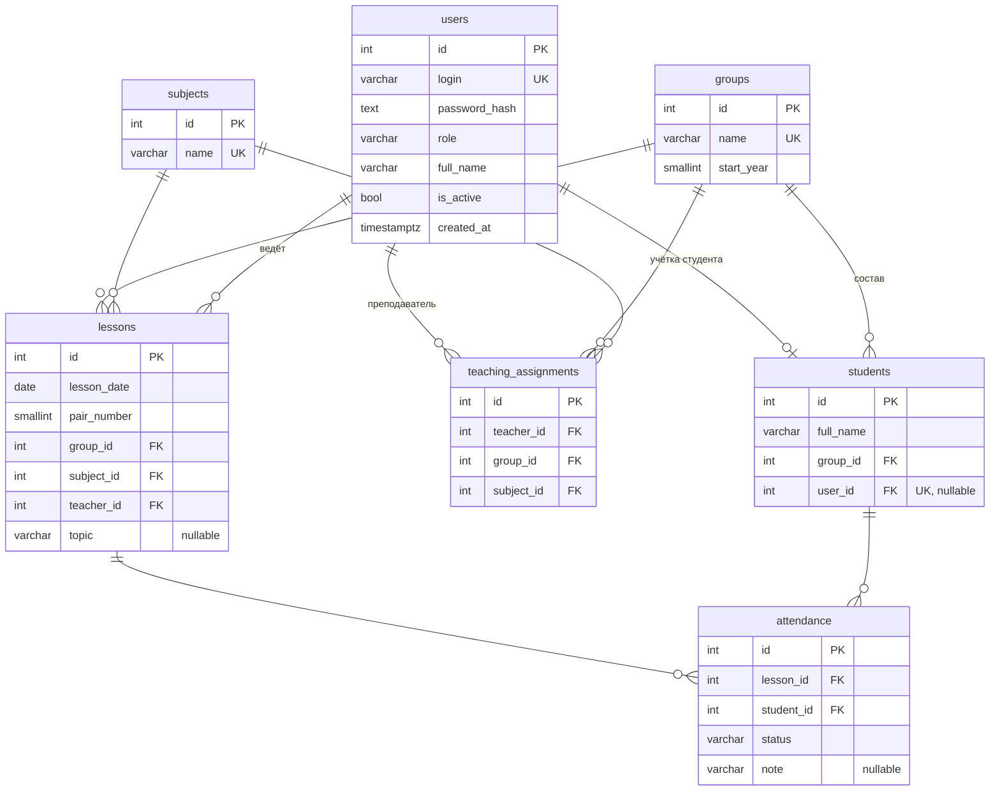

# Спецификация: веб-приложение учёта посещаемости студентов

Документ для сборки проекта. Печатный документ для учителя — отдельный файл (`PROJECT_DOC.docx`).

## 1. Цель и границы

Автоматизировать ведение журнала посещаемости: преподаватель отмечает присутствие на занятиях, администратор ведёт справочники и учётные записи, студент просматривает свою посещаемость.

Входит: авторизация по ролям, справочники, назначения преподавателей, уроки, отметка посещаемости, отчёты, поиск.
Не входит: свободная регистрация, расписание в виде календаря, уведомления, импорт/экспорт, несколько языков (интерфейс только на русском), мобильное приложение, Docker, JWT, микросервисы.

## 2. Стек и версии

| Компонент | Версия / решение |
|---|---|
| Среда выполнения | .NET 10 (LTS), ASP.NET Core 10 |
| ORM | EF Core 10, провайдер Npgsql для EF Core 10, миграции |
| СУБД | PostgreSQL 18 |
| Frontend | HTML5, CSS3, JavaScript (ES2020+), без фреймворков и сборщиков |
| Статика | `wwwroot` того же приложения (один origin, без CORS) |
| Шрифты | Локально в `wwwroot/fonts` |
| Дизайн | Единый источник — `mockups/!DESIGN_TOKENS.html`, значения переносятся в CSS-переменные |

Точные номера патч-версий пакетов фиксируются при создании проекта и записываются в `RUN.md`.

## 3. Роли и права

| Роль | Может |
|---|---|
| `admin` | Управлять пользователями, группами, студентами, предметами, назначениями; видеть все отчёты |
| `teacher` | Видеть только свои назначения (группа + предмет); создавать и вести уроки по ним; отмечать посещаемость; смотреть отчёты по своим группам и предметам |
| `student` | Только читать свою посещаемость |

Права проверяются на сервере (политики авторизации и проверка владения данными в каждом обработчике). Скрытие кнопок в JS — только удобство, не защита.

Учётные записи создаёт только админ: логин и временный пароль. Студент может сменить пароль сам.

## 4. Модель данных

Идентификаторы — `integer generated always as identity`. Даты урока — `date` (без часового пояса). Служебные метки времени — `timestamptz`.



### Ограничения

- `users.role` ∈ `admin`, `teacher`, `student` (CHECK).
- `students.user_id` уникален, может быть пустым (студент без доступа в систему).
- `teaching_assignments`: уникальна тройка (`teacher_id`, `group_id`, `subject_id`); `teacher_id` должен указывать на пользователя с ролью `teacher` (проверяется в приложении).
- `lessons`: `pair_number` от 1 до 8; уникальна тройка (`group_id`, `lesson_date`, `pair_number`); (`teacher_id`, `group_id`, `subject_id`) должна существовать в назначениях (проверка в приложении).
- `attendance.status` ∈ `present`, `absent`, `excused`, `late` (CHECK); уникальна пара (`lesson_id`, `student_id`); студент должен принадлежать группе урока (проверка в приложении).
- Все внешние ключи — `ON DELETE RESTRICT`. Удаление записи, на которую есть ссылки, запрещено; API отвечает 409 с понятным сообщением. Для учётных записей доступно отключение (`is_active = false`).
- Индексы: по всем внешним ключам, `attendance(student_id, lesson_id)`, `lessons(group_id, lesson_date)`.

### Правила расчёта

- Отметки нет — студент на занятии «не отмечен» и в расчёт не входит.
- Процент посещаемости = (`present` + `late`) / (все отметки − `excused`) × 100. Если знаменатель равен 0, показывается «—».
- Формула принята в спецификации и может быть изменена до начала реализации отчётов.

## 5. API

Формат — JSON, префикс `/api`. Ошибки — `ProblemDetails` (RFC 7807): 400 валидация, 401 не авторизован, 403 нет прав, 404 не найдено, 409 конфликт (дубль или есть связанные данные).

| Метод и путь | Роли | Назначение |
|---|---|---|
| `POST /api/auth/login` | все | Вход, выдаёт cookie |
| `POST /api/auth/logout` | все | Выход |
| `GET /api/auth/me` | все | Текущий пользователь и роль |
| `POST /api/auth/change-password` | все | Смена своего пароля |
| `GET/POST/PUT /api/users`, `POST /api/users/{id}/reset-password`, `DELETE /api/users/{id}` | admin | Учётные записи (DELETE — с запретом при связях) |
| `GET/POST/PUT/DELETE /api/groups` | admin (чтение — teacher) | Группы |
| `GET/POST/PUT/DELETE /api/subjects` | admin (чтение — teacher) | Предметы |
| `GET/POST/PUT/DELETE /api/students` (`?q=&groupId=`) | admin; teacher — чтение своих групп | Студенты, поиск по ФИО |
| `GET/POST/DELETE /api/assignments` | admin | Назначения преподавателей |
| `GET /api/my/assignments` | teacher | Свои группы и предметы |
| `GET /api/lessons` (`?groupId=&subjectId=&from=&to=`) | admin, teacher (только свои) | Список уроков |
| `POST/PUT/DELETE /api/lessons` | teacher (только по своим назначениям) | Урок |
| `GET /api/lessons/{id}/attendance` | admin, teacher (свои) | Состав группы с отметками |
| `PUT /api/lessons/{id}/attendance` | teacher (свои) | Сохранить отметки списком |
| `GET /api/reports/student/{id}` (`?from=&to=&subjectId=`) | admin, teacher (свои группы) | Отчёт по студенту |
| `GET /api/reports/group/{id}` (`?from=&to=&subjectId=`) | admin, teacher (свои) | Отчёт по группе |
| `GET /api/me/attendance` (`?from=&to=&subjectId=`) | student | Своя посещаемость |

## 6. Экраны (макеты в `mockups/`)

1. Вход.
2. Группы и студенты (admin): списки, поиск, форма, создание учётной записи студента.
3. Пользователи и назначения (admin).
4. Предметы (admin).
5. Мои занятия (teacher): список уроков, создание урока.
6. Отметка посещаемости (teacher): список группы, статус на каждого, сохранение одним действием.
7. Отчёты (admin, teacher): по группе и по студенту, фильтры по датам и предмету.
8. Кабинет студента: своя посещаемость по предметам и процент.
9. Смена пароля.

Адаптивность: ширина от 360 px; таблицы на узких экранах превращаются в карточки.

## 7. Безопасность

- Пароли — только хеш (`PasswordHasher`), минимальная длина 8 символов. Пароль не пишется в логи.
- Cookie: `HttpOnly`, `SameSite=Strict`; изменяющие запросы дополнительно требуют заголовок `X-Requested-With` (защита от CSRF).
- Строка подключения и пароль первого админа — в пользовательских секретах или переменных окружения, не в git.
- Первый админ создаётся при старте из конфигурации, если в `users` нет ни одного админа.
- Запросы только через EF Core (параметризованные), вывод на странице — через `textContent`, а не `innerHTML` с данными.
- Одинаковое сообщение при неверном логине и неверном пароле.

## 8. Предусмотренные ошибки

| Риск | Мера |
|---|---|
| Сдвиг даты из-за часового пояса | Дата урока — `date`, без времени |
| Дубль отметки | Уникальный индекс (`lesson_id`, `student_id`) + `PUT` заменяет весь список |
| Потеря истории при удалении | `ON DELETE RESTRICT`, ответ 409 |
| Доступ к чужим данным | Проверка владения на сервере в каждом обработчике; тесты по трём ролям |
| Студент вне группы урока | Проверка в приложении при сохранении отметок |
| Два урока в одно время у группы | Уникальность (`group_id`, `lesson_date`, `pair_number`) |
| Сбой на защите | `RUN.md`, скрипты `db/schema.sql`, `db/seed.sql`, дамп, проверка на чистой установке |
| Расхождение миграций и схемы | Единственный источник схемы — миграции EF; `db/schema.sql` генерируется из них |
| Нет интернета | Шрифты и иконки локально |

## 9. Структура репозитория

```
docs/        PLAN.md, SPEC.md, DB_STRUCTURE.xlsx, ERD.png/svg, RUN.md, PROJECT_DOC.docx
mockups/     макеты HTML, !DESIGN_TOKENS.html
src/         решение .NET (API + wwwroot)
db/          schema.sql, seed.sql, дамп
```

## 10. Критерии готовности

1. Проект запускается с нуля по `RUN.md`.
2. Три роли входят и видят только разрешённое.
3. Работают: добавление, редактирование, удаление (с запретом при связях) и поиск по справочникам.
4. Преподаватель создаёт урок по своему назначению и сохраняет отметки.
5. Отчёты считают процент по формуле из раздела 4.
6. Интерфейс соответствует принятым макетам и работает от 360 px.
7. Демо-данные загружаются одним скриптом.

## 11. Открытые вопросы

- Требования учителя к печатному документу (нужны до начала дня 3).
- Подтверждение формулы процента посещаемости.
